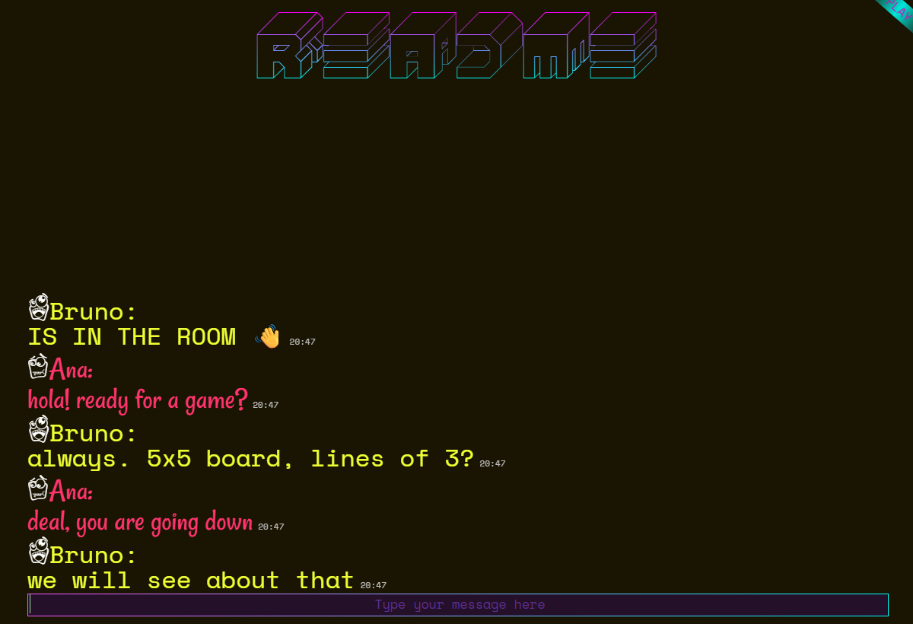
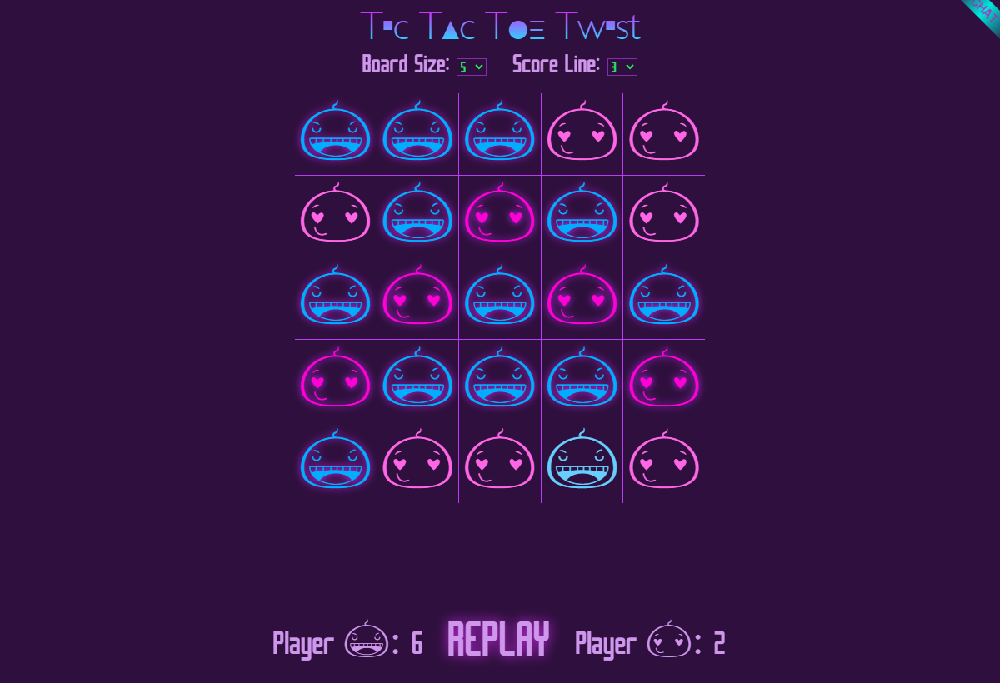
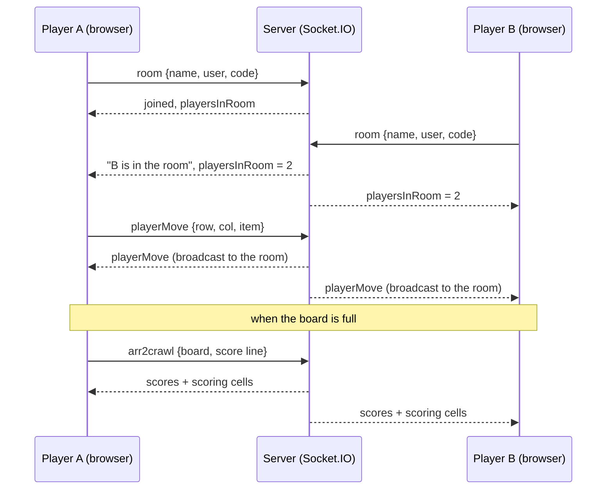

# Charla

**Private chat rooms in seconds, with a Tic Tac Toe twist you can play while you talk.**

Pick a name, a room and a code, share them with a friend, and you're in. No sign-up, nothing stored: a room exists only while someone is in it. Everything is synced live over WebSockets.

**Live demo:** https://powerchat.netlify.app/ (open it in two tabs to try it alone)

<p align="center">
  
  
</p>

## Features

- **Instant private rooms.** The first person to use a room name sets its code; anyone else needs that code to get in. When the last person leaves, the room is gone.
- **Personality per person.** Everyone gets a random face, colour and font, so you can tell who's talking at a glance.
- **Live presence.** Joins and leaves are announced, and a short network blip doesn't trigger a false "left the room".
- **A game built into the chat.** While the room has one or two people, either can switch to Tic Tac Toe Twist and back to the chat at any time.

## Tic Tac Toe Twist

Classic Tic Tac Toe always ends in a draw between good players. The twist changes the goal:

1. **Pick a board size** from 3x3 up to 12x12 (up to 8x8 on phones and small screens).
2. **Pick a score line**: how many in a row make a point (3 or more, no longer than the board).
3. **Fill the whole board.** Nobody wins halfway; players alternate until every cell is taken.
4. **Every line scores.** Rows, columns and both diagonals are counted, and each full score line in a row is a point: with lines of 3, four in a row is 1 point and six in a row is 2. The scoring cells light up and the higher total wins.

On bigger boards with longer lines it becomes a game of blocking and building several lines at once, closer to Gomoku than to Tic Tac Toe. Either player can change the board or the score line, or replay, and the change applies to both screens.

## How it works



- **Client:** React. One Socket.IO connection per tab carries both the chat and the game.
- **Server:** Node.js with Socket.IO and no database. Rooms are Socket.IO rooms, with the room code kept in memory next to them. A per-room guest count, keyed by name, tells a real departure apart from a quick reconnect.
- **Trust:** the server validates every game message (board shape and size, move ranges, score line) before relaying or scoring it, so a modified client can't crash it or flood other players with a giant board.
- **Scoring:** `server/crawler.js` walks every row, column and diagonal of the finished board and counts runs. It was checked against a brute-force implementation on 2,000 random boards.

### Socket events

| Event | Direction | Purpose |
| --- | --- | --- |
| `room` | client → server | Join or create a room (`name`, `user`, `code`) |
| `message` | both | Chat message, broadcast to the room |
| `playersInRoom` | server → client | Number of people in the room |
| `playerMove` | both | A move, broadcast to the room |
| `colChange` / `winLineChange` | both | Board size or score line changed (also used for replay) |
| `arr2crawl` | both | Finished board sent for scoring; scores broadcast back |

## Running locally

Requires Node.js 18 or newer. From the repository root:

```sh
npm run install:all   # first time only
npm run dev           # server on :8000 + client on :3000
```

Open http://localhost:3000 in two tabs to chat and play against yourself. The local client talks to the local server automatically (see `client/.env.development`).

```sh
npm test              # client unit tests
```

## Project structure

```
charla/
├── client/            React app (Create React App)
│   └── src/
│       ├── Main.jsx              chat, rooms, connection handling
│       ├── components/TTT.jsx    Tic Tac Toe Twist
│       └── tools/                faces, colours, word filter
├── server/
│   ├── server.js      Socket.IO server: rooms, presence, relaying
│   ├── crawler.js     scoring
│   └── validate.js    checks for incoming game messages
└── docs/screenshots/
```

## Deployment

| Part | Host | Settings |
| --- | --- | --- |
| Client | Netlify | Base directory `client`, build `npm run build`, publish `client/build` |
| Server | Koyeb | Work directory `server`, port 8000, TCP health check |

The client connects to the live server by default. Set `REACT_APP_SERVER_URL` to point a build at another server.

## What's next

- Move the game state onto the server, so it decides whose turn it is, rejects illegal moves and can restore a game after a reconnect.
- Move the word filter to the server (today it only runs in the browser).
- Migrate from Create React App to Vite.
- Add server tests for rooms and presence.

## Background

*Charla* means "chat" in Spanish. The project began as two repositories, one for the client and one for the server, and was merged into this one with its full history.

Built by Fel · [cardini.dev](https://cardini.dev)
